# Comprehensive Android Architecture & Technical Implementation Analysis
## Personal Task Manager (Compose-Demo)

---

## Executive Summary & System Overview

The **Personal Task Manager** application is a production-ready, offline-first Android application designed according to **Clean Architecture** principles, **MVVM (Model-View-ViewModel)** design pattern, **Declarative Jetpack Compose UI**, **Room Persistence**, **Retrofit 2 REST Networking**, **WorkManager Background Processing**, **Android System Receivers & Content Providers**, and **Explicit Manual Dependency Injection (`AppContainer`)**.

This document presents an exhaustive technical breakdown of:
1. **What is used** in the codebase and **how it is used** with exact file references.
2. **Comparative Analysis**: Trade-offs and differences between the chosen approach and alternative industry approaches.
3. **Internal Engine Mechanics**: How Android system components and libraries function under the hood.
4. **Google Developer Guide References**: Citations to official Google Android documentation and industry standards.

---

## 1. Architectural Topology & Layering Analysis

```mermaid
graph TD
    subgraph Presentation ["1. Presentation Layer (UI & MVVM)"]
        MA["[MainActivity](file:///c:/Users/navne/StudioProjects/Compose-demo/app/src/main/java/com/example/ui/activity/MainActivity.kt)"]
        NH["[NavigationHandler](file:///c:/Users/navne/StudioProjects/Compose-demo/app/src/main/java/com/example/ui/navigation/NavigationHandler.kt)"]
        TLF["[TaskListFragment](file:///c:/Users/navne/StudioProjects/Compose-demo/app/src/main/java/com/example/ui/fragment/TaskListFragment.kt)"]
        TDF["[TaskDetailFragment](file:///c:/Users/navne/StudioProjects/Compose-demo/app/src/main/java/com/example/ui/fragment/TaskDetailFragment.kt)"]
        TAF["[TaskAnalyticsFragment](file:///c:/Users/navne/StudioProjects/Compose-demo/app/src/main/java/com/example/ui/fragment/TaskAnalyticsFragment.kt)"]
        SF["[SettingsFragment](file:///c:/Users/navne/StudioProjects/Compose-demo/app/src/main/java/com/example/ui/fragment/SettingsFragment.kt)"]
        TLS["[TaskListScreen](file:///c:/Users/navne/StudioProjects/Compose-demo/app/src/main/java/com/example/ui/screens/TaskListScreen.kt)"]
        TDS["[TaskDetailScreen](file:///c:/Users/navne/StudioProjects/Compose-demo/app/src/main/java/com/example/ui/screens/TaskDetailScreen.kt)"]
        TAS["[TaskAnalyticsScreen](file:///c:/Users/navne/StudioProjects/Compose-demo/app/src/main/java/com/example/ui/screens/TaskAnalyticsScreen.kt)"]
        SS["[SettingsScreen](file:///c:/Users/navne/StudioProjects/Compose-demo/app/src/main/java/com/example/ui/screens/SettingsScreen.kt)"]
        VM["[TaskViewModel](file:///c:/Users/navne/StudioProjects/Compose-demo/app/src/main/java/com/example/ui/viewmodel/TaskViewModel.kt)"]
        UIS["[TaskUiState](file:///c:/Users/navne/StudioProjects/Compose-demo/app/src/main/java/com/example/ui/model/TaskUiState.kt)"]
    end

    subgraph Domain ["2. Domain Layer (Pure Business Logic)"]
        UC1["[GetTasksUseCase](file:///c:/Users/navne/StudioProjects/Compose-demo/app/src/main/java/com/example/domain/usecase/GetTasksUseCase.kt)"]
        UC2["[AddTaskUseCase](file:///c:/Users/navne/StudioProjects/Compose-demo/app/src/main/java/com/example/domain/usecase/AddTaskUseCase.kt)"]
        UC3["[UpdateTaskUseCase](file:///c:/Users/navne/StudioProjects/Compose-demo/app/src/main/java/com/example/domain/usecase/UpdateTaskUseCase.kt)"]
        UC4["[DeleteTaskUseCase](file:///c:/Users/navne/StudioProjects/Compose-demo/app/src/main/java/com/example/domain/usecase/DeleteTaskUseCase.kt)"]
        UC5["[SyncTasksUseCase](file:///c:/Users/navne/StudioProjects/Compose-demo/app/src/main/java/com/example/domain/usecase/SyncTasksUseCase.kt)"]
        UC6["[GetTaskStatsUseCase](file:///c:/Users/navne/StudioProjects/Compose-demo/app/src/main/java/com/example/domain/usecase/GetTaskStatsUseCase.kt)"]
        DM["[Task Model](file:///c:/Users/navne/StudioProjects/Compose-demo/app/src/main/java/com/example/domain/model/Task.kt)"]
        TR_INT["[TaskRepository Interface](file:///c:/Users/navne/StudioProjects/Compose-demo/app/src/main/java/com/example/domain/repository/TaskRepository.kt)"]
    end

    subgraph Data ["3. Data Layer (Persistence, Remote & OS Services)"]
        TR_IMPL["[TaskRepositoryImpl](file:///c:/Users/navne/StudioProjects/Compose-demo/app/src/main/java/com/example/data/repository/TaskRepositoryImpl.kt)"]
        TDB["[TaskDatabase](file:///c:/Users/navne/StudioProjects/Compose-demo/app/src/main/java/com/example/data/local/TaskDatabase.kt)"]
        TDAO["[TaskDao](file:///c:/Users/navne/StudioProjects/Compose-demo/app/src/main/java/com/example/data/local/TaskDao.kt)"]
        TENT["[TaskEntity](file:///c:/Users/navne/StudioProjects/Compose-demo/app/src/main/java/com/example/data/local/TaskEntity.kt)"]
        TAPI["[TaskApiService](file:///c:/Users/navne/StudioProjects/Compose-demo/app/src/main/java/com/example/data/remote/TaskApiService.kt)"]
        MNI["[MockNetworkInterceptor](file:///c:/Users/navne/StudioProjects/Compose-demo/app/src/main/java/com/example/data/remote/MockNetworkInterceptor.kt)"]
        WMS["[WorkManagerScheduler](file:///c:/Users/navne/StudioProjects/Compose-demo/app/src/main/java/com/example/data/worker/WorkManagerScheduler.kt)"]
        SW["[SyncWorker](file:///c:/Users/navne/StudioProjects/Compose-demo/app/src/main/java/com/example/data/worker/SyncWorker.kt)"]
        TRW["[TaskReminderWorker](file:///c:/Users/navne/StudioProjects/Compose-demo/app/src/main/java/com/example/data/worker/TaskReminderWorker.kt)"]
        NCR["[NetworkConnectivityReceiver](file:///c:/Users/navne/StudioProjects/Compose-demo/app/src/main/java/com/example/data/receiver/NetworkConnectivityReceiver.kt)"]
        CPM["[ContactsProviderManager](file:///c:/Users/navne/StudioProjects/Compose-demo/app/src/main/java/com/example/data/provider/ContactsProviderManager.kt)"]
    end

    subgraph DI ["4. Dependency Injection"]
        AC["[AppContainer](file:///c:/Users/navne/StudioProjects/Compose-demo/app/src/main/java/com/example/di/AppContainer.kt)"]
    end

    MA --> NH
    TLF --> VM
    TDF --> VM
    TAF --> VM
    SF --> VM
    VM --> UIS
    VM --> UC1
    VM --> UC2
    VM --> UC3
    VM --> UC4
    VM --> UC5
    VM --> UC6
    UC1 --> TR_INT
    UC2 --> TR_INT
    UC3 --> TR_INT
    UC4 --> TR_INT
    UC5 --> TR_INT
    UC6 --> TR_INT
    TR_IMPL --> TR_INT
    TR_IMPL --> TDAO
    TDAO --> TDB
    TDAO --> TENT
    TR_IMPL --> TAPI
    TAPI --> MNI
    TR_IMPL --> WMS
    WMS --> SW
    WMS --> TRW
    SW --> TR_INT
    NCR --> TR_INT
    TDS --> CPM
    AC --> TR_IMPL
    AC --> TDB
    AC --> TAPI
    AC --> WMS
    AC --> VM
```



---

## 2. Exhaustive Technical Components Breakdown

### 2.1 Clean Architecture + MVVM Pattern
- **What is used**:
  - The application is segregated into three strict layers: **Presentation**, **Domain**, and **Data**.
  - **Domain Layer**: Contains pure Kotlin data classes (`Task`, `Category`, `Priority`, `SyncStatus`), abstract interface definitions (`TaskRepository`), and fine-grained Use Case interactors (`GetTasksUseCase`, `AddTaskUseCase`, `UpdateTaskUseCase`, `DeleteTaskUseCase`, `SyncTasksUseCase`, `GetTaskStatsUseCase`).
  - **Presentation Layer**: Utilizes `TaskViewModel` observing asynchronous data streams from Domain Use Cases and exposing a single unified state wrapper (`StateFlow<TaskUiState>`).
  - **Data Layer**: Implements `TaskRepositoryImpl`, mapping data models across boundaries using extension mappers (`toEntity()`, `toDomain()`, `toDto()`).
- **How it is used**:
  - `TaskViewModel` accepts single-responsibility use cases in its constructor:
    ```kotlin
    class TaskViewModel(
        private val savedStateHandle: SavedStateHandle,
        private val getTasksUseCase: GetTasksUseCase,
        private val addTaskUseCase: AddTaskUseCase,
        private val updateTaskUseCase: UpdateTaskUseCase,
        private val deleteTaskUseCase: DeleteTaskUseCase,
        private val syncTasksUseCase: SyncTasksUseCase,
        private val getTaskStatsUseCase: GetTaskStatsUseCase
    ) : ViewModel()
    ```
  - Data flows reactively from Room DAO -> Repository -> Use Case -> ViewModel -> Compose UI using Kotlin `Flow`.

---

### 2.2 Local Database & Offline-First Strategy (Room ORM)
- **What is used**:
  - **Room Database 2.6+**: `@Entity` (`TaskEntity`), `@Dao` (`TaskDao`), and `@Database` (`TaskDatabase`).
  - Coroutine `Flow` return types for database reads, and `suspend` functions for writes.
- **How it is used**:
  - `TaskDao` defines reactive queries:
    ```kotlin
    @Query("SELECT * FROM tasks ORDER BY createdAtMillis DESC")
    fun getAllTasks(): Flow<List<TaskEntity>>

    @Insert(onConflict = OnConflictStrategy.REPLACE)
    suspend fun insertTask(task: TaskEntity)
    ```
  - **Offline-First Synchronization Pipeline**:
    1. Writes (`addTask`, `updateTask`, `deleteTask`) mutate local Room database **immediately** with a `SyncStatus` flag (`PENDING_INSERT`, `PENDING_UPDATE`, or `PENDING_DELETE`).
    2. UI updates instantaneously because Compose observes the Room `Flow`.
    3. `WorkManagerScheduler` triggers a non-blocking background `SyncWorker` to sync pending local changes with the remote REST server via Retrofit.

---

### 2.3 Declarative UI Engine (Jetpack Compose + Material 3)
- **What is used**:
  - **Jetpack Compose (Material 3)**: Pure declarative UI composables (`TaskListScreen`, `TaskDetailScreen`, `TaskAnalyticsScreen`, `SettingsScreen`, `TaskCard`, `ContactPicker`).
  - State management via `collectAsStateWithLifecycle()` from `androidx.lifecycle.runtime.compose`.
  - Hybrid Fragment host wrappers (`TaskListFragment`, `TaskDetailFragment`, `TaskAnalyticsFragment`, `SettingsFragment`) demonstrating integration between traditional Android Jetpack Navigation Fragments and Compose `ComposeView`.
- **How it is used**:
  - Composables are stateless and accept state and lambdas:
    ```kotlin
    @Composable
    fun TaskListScreen(
        uiState: TaskUiState,
        onSearchQueryChange: (String) -> Unit,
        onCategorySelect: (Category?) -> Unit,
        onTaskClick: (String) -> Unit,
        onToggleComplete: (Task) -> Unit
    )
    ```

---

### 2.4 Asynchronous Data Streaming (Kotlin Coroutines & Flow)
- **What is used**:
  - **Kotlin Coroutines**: `viewModelScope`, `Dispatchers.IO`, `Dispatchers.Main`, `suspend` functions.
  - **Kotlin Flow**: `Flow<T>`, `StateFlow<T>`, `combine()`, `stateIn()`.
- **How it is used**:
  - In `TaskViewModel`, filter states (query, category, priority, completion) are stored in `MutableStateFlow` and combined with database flows:
    ```kotlin
    val tasksState: StateFlow<List<Task>> = combine(
        _searchQuery,
        _selectedCategory,
        _selectedPriority,
        _showCompletedOnly
    ) { query, category, priority, completedOnly ->
        getTasksUseCase(query, category, priority, completedOnly)
    }.flatMapLatest { flow -> flow }
     .stateIn(viewModelScope, SharingStarted.WhileSubscribed(5000), emptyList())
    ```

---

### 2.5 REST Networking & Serialization (Retrofit 2 + Moshi + OkHttp)
- **What is used**:
  - **Retrofit 2**: `TaskApiService` with `@GET`, `@POST`, `@DELETE`, `@Headers`.
  - **Moshi JSON Library**: `KotlinJsonAdapterFactory` for type-safe null-aware JSON parsing.
  - **OkHttp 4**: `HttpLoggingInterceptor` for debugging and custom `MockNetworkInterceptor` for simulating remote REST responses without requiring an active external server.
- **How it is used**:
  - `MockNetworkInterceptor` intercepts requests to `https://api.taskmanager.example.com/` and synthesizes realistic HTTP 200/201 JSON responses, enabling robust offline testing and development.

---

### 2.6 Background Job Scheduling & Notifications (WorkManager)
- **What is used**:
  - **WorkManager**: `WorkManagerScheduler`, `SyncWorker` (`CoroutineWorker`), `TaskReminderWorker` (`CoroutineWorker`).
  - System `NotificationManager` for displaying local push notifications when task reminders trigger.
- **How it is used**:
  - `SyncWorker` executes background data sync when network state is `CONNECTED`:
    ```kotlin
    val constraints = Constraints.Builder()
        .setRequiredNetworkType(NetworkType.CONNECTED)
        .build()

    val syncRequest = OneTimeWorkRequestBuilder<SyncWorker>()
        .setConstraints(constraints)
        .setBackoffCriteria(BackoffPolicy.EXPONENTIAL, 15, TimeUnit.SECONDS)
        .build()
    ```
  - `TaskReminderWorker` schedules exact delay notifications based on task due date timestamps (`delayInMillis = dueDate - currentTime`).

---

### 2.7 System Integration (BroadcastReceiver & ContentProvider)
- **What is used**:
  - **BroadcastReceiver**: `NetworkConnectivityReceiver` monitoring `android.net.conn.CONNECTIVITY_CHANGE`.
  - **ContentProvider Manager**: `ContactsProviderManager` executing queries against `ContactsContract.CommonDataKinds.Phone.CONTENT_URI` using `ContentResolver`.
- **How it is used**:
  - When the user turns on Wi-Fi or cellular data, `NetworkConnectivityReceiver` fires a trigger to `TaskRepository.syncTasks()`.
  - When creating or editing a task, `ContactsProviderManager` reads device contacts to allow selecting and attaching team members directly to tasks.

---

### 2.8 Dependency Injection (Manual AppContainer vs. Hilt)
- **What is used**:
  - **AppContainer**: An explicit manual dependency injection container instantiated inside `TaskApplication`.
  - Custom `ViewModelProvider.Factory` for injecting use cases into `TaskViewModel`.
  - Dual compatibility: Build configuration includes Hilt annotations (`@HiltAndroidApp`, `@AndroidEntryPoint`, `@Inject`) for instant migration to Hilt if required.
- **How it is used**:
  - Singletons (`TaskDatabase`, `Retrofit`, `TaskRepositoryImpl`, `WorkManagerScheduler`) are lazy-evaluated thread-safely via Kotlin `by lazy`.

---

## 3. Comparative Architectural & Technology Analysis

### 3.1 Architectural Pattern: Clean Architecture + MVVM vs. Monolithic / Standard MVVM

| Criterion | Clean Architecture + MVVM (Implemented) | Standard MVVM / Monolithic |
| :--- | :--- | :--- |
| **Separation of Concerns** | Strict: Domain layer is 100% pure Kotlin with zero Android framework imports (`android.*`). | Loose: ViewModel directly imports Room DAOs, Retrofit APIs, or SharedPreferences. |
| **Testability** | **Exceptional**: Use cases and domain repositories can be unit-tested on standard JVM in milliseconds without Android Mocks. | **Moderate/Poor**: Requires `Robolectric` or Android Instrumentation tests due to framework coupling. |
| **Maintainability & Scale** | **High**: Business rules live in Use Cases (`AddTaskUseCase`). Changing UI or DB framework does not affect business logic. | **Low**: Logic is scattered across ViewModels, Activity/Fragments, or DB DAOs. |
| **Code Boilerplate** | Higher (Requires Use Cases, Mappers, Repository Interfaces). | Lower (Direct call from ViewModel to DAO/API). |
| **Build Overhead** | Zero extra compilation overhead when using pure Kotlin domain modules. | Fast initial build, but tech debt scales exponentially. |

> **Google Developer Guidance**: *"A clean architecture segregates software into layers to isolate business logic from UI and data source implementation details."* ([Guide to App Architecture](https://developer.android.com/topic/architecture))

---

### 3.2 UI Engine: Declarative Jetpack Compose vs. Imperative XML Views

| Feature | Jetpack Compose (Implemented) | Traditional XML Layouts & Views |
| :--- | :--- | :--- |
| **Paradigm** | **Declarative**: UI automatically rebuilds (recomposes) when state changes. | **Imperative**: Developer manually mutates views (`textView.setText()`, `view.setVisibility()`). |
| **Code Volume** | **~40-60% less code**: No XML files, ViewBinding, or custom View subclasses required. | High: Separate XML layout files, style XMLs, attr XMLs, and Kotlin binding code. |
| **State Synchronization** | Single Source of Truth (SSOT). Impossible for UI state to desynchronize from model state. | High risk of UI desynchronization bugs (e.g., forgotten `setVisibility(GONE)` calls). |
| **Animation & Styling** | Built-in Kotlin animation primitives (`AnimatedVisibility`, `animateColorAsState`). | Complex `ValueAnimator`, `ObjectAnimator`, or XML state list drawables. |
| **Performance** | Smart recomposing via slot table skip checks; no XML parsing overhead at runtime. | XML layout inflation (`XmlResourceParser`) involves expensive reflection and disk I/O. |

> **Google Developer Guidance**: *"Jetpack Compose simplifies and accelerates UI development on Android with less code, powerful tools, and intuitive Kotlin APIs."* ([Compose Mental Model](https://developer.android.com/jetpack/compose/mental-model))

---

### 3.3 Database Engine: Room Database vs. Raw SQLite / Realm / DataStore

| Engine | Type Safety | Async Engine | Reactive Streams | Use Case Best Fit |
| :--- | :--- | :--- | :--- | :--- |
| **Room ORM (Implemented)** | **Compile-Time** (SQL query verification via KSP) | Kotlin Coroutines (`suspend`) | Kotlin `Flow`, `PagingSource` | Relational local data with reactive UI updates. |
| **Raw SQLiteOpenHelper** | Runtime only (Syntax errors crash app at runtime) | Manual background threads | Manual Callback/Listener | Legacy apps or zero-dependency micro-libraries. |
| **Realm Object DB** | Compile-Time (Java/Kotlin models) | Custom Realm async API | RealmResults ChangeListeners | Non-SQL object graphs, but adds ~3-5MB APK size. |
| **Jetpack DataStore** | Type-safe via Protocol Buffers | Coroutines / Flow | `Flow<Preferences>` | Simple key-value pairs or lightweight settings. |

---

### 3.4 Background Scheduling: WorkManager vs. AlarmManager / JobScheduler / Foreground Service

| API | Execution Guarantee | Battery Optimization | Execution Window | Primary Purpose |
| :--- | :--- | :--- | :--- | :--- |
| **WorkManager (Implemented)** | **Guaranteed** (Persisted to SQLite DB across reboots) | Fully compliant with Doze mode & App Standby | Deferrable or Constrained | Background sync, file uploads, periodic cleanup. |
| **AlarmManager** | High (triggers exact intent) | Exempt from Doze if `setExactAndAllowWhileIdle` | Exact time instant | Clock alarms, calendar reminders (short tasks). |
| **JobScheduler** | High (API 21+) | Doze mode aware | Constraint-based | System-level jobs (Replaced by WorkManager). |
| **Foreground Service** | Immediate execution | High battery consumption (Requires persistent notification) | Immediate ongoing | Audio playback, turn-by-turn GPS navigation. |

> **Google Developer Guidance**: *"WorkManager is the recommended solution for persistent work. Work is persistent if it remains scheduled through app restarts and system reboots."* ([WorkManager Guide](https://developer.android.com/topic/libraries/architecture/workmanager))

---

### 3.5 Dependency Injection: Manual AppContainer vs. Hilt vs. Koin

| DI Solution | Resolution Mechanics | Compile Time Overhead | Runtime Overhead | Error Detection |
| :--- | :--- | :--- | :--- | :--- |
| **Manual AppContainer (Implemented)** | Explicit Kotlin object graph (`by lazy`) | **0 ms** (Zero code generation) | Zero (Direct reference) | Instant Kotlin compiler check |
| **Google Hilt / Dagger** | Annotation Processing (KSP / KAPT) | +15-30% build time increase | Zero (Static factory code generated) | Compile-time dependency graph validation |
| **Koin** | Service Locator / Reflection DSL | 0 ms build time | Small lookup reflection overhead | Runtime exception if dependency missing |

---

### 3.6 JSON Serialization: Moshi vs. Gson vs. Kotlinx Serialization

| Library | Kotlin Null-Safety | Default Parameter Values | Adapter Engine | Performance |
| :--- | :--- | :--- | :--- | :--- |
| **Moshi (Implemented)** | **Full**: Enforces non-null Kotlin types (`String` vs `String?`) | **Supported** via `KotlinJsonAdapterFactory` | CodeGen / Reflection | High (Optimized stream parser) |
| **Gson** | **Broken**: Uses unsafe `UnsafeAllocator`, injecting `null` into non-nullable types! | **Ignored**: Bypasses Kotlin default constructor values | Reflection only | Moderate (Legacy) |
| **Kotlinx Serialization** | **Full**: Native Kotlin compiler plugin | **Supported** natively | Compiler Plugin Bytecode | Exceptional (Zero reflection) |

---

## 4. Deep Technical Mechanics & Under-the-Hood Operations

### 4.1 Jetpack Compose Recomposition Engine & Slot Table
Jetpack Compose does not use Android `View` objects or `Canvas` redrawing for every state change. Instead, it operates via a **Slot Table** architecture:
1. **Applier & Slot Table**: During initial composition, Compose records the hierarchy of composables and their parameters into a bit-stream data structure called the Slot Table.
2. **Recomposition Skip Optimization**: When state changes (e.g. `TaskUiState.searchQuery`), the Compose compiler checks which composables read that state. If a composables parameters are `@Stable` or `Immutable` and haven't changed, Compose **skips** executing that composable function entirely.
3. **Layout & Render Nodes**: Composables emit `LayoutNode` objects, which execute single-pass measurement and placement (`MeasurePolicy`), drastically outperforming traditional XML nested layout passes.

```
State Change Triggered -> Slot Table Scan -> Stable Parameter Check -> Skip Unchanged Composables -> Recompose Changed Composables -> Draw LayoutNode
```

---

### 4.2 Room Database Annotation Processing via KSP
When the project compiles, **Kotlin Symbol Processing (KSP)** inspects `@Dao` and `@Entity` annotations:
1. `TaskEntity` generates SQLite `CREATE TABLE tasks (...)` schema definitions.
2. `TaskDao` generates `TaskDao_Impl.java/kt`, implementing SQL binding code, cursor traversal, and Coroutine `Flow` invalidation tracking.
3. Room registers an `InvalidationTracker` listener on the underlying SQLite database. Whenever `INSERT`, `UPDATE`, or `DELETE` executes on `tasks`, Room notifies the `Flow` observer, automatically streaming updated data to `TaskViewModel`.

---

### 4.3 WorkManager Persistence Architecture
Unlike in-memory timers, WorkManager guarantees execution across app kills and system reboots through a SQLite persistent database engine:
1. When `workManagerScheduler.scheduleOneTimeSync()` is called, WorkManager inserts a row into its internal system database (`/data/data/com.example/databases/androidx.work.workdb`).
2. The job request includes constraints (e.g. `NetworkType.CONNECTED`).
3. WorkManager registers a system `JobScheduler` (on API 23+) or `AlarmManager` trigger.
4. Even if the device reboots, WorkManager's `RescheduleReceiver` receives `ACTION_BOOT_COMPLETED`, inspects `workdb`, and restores pending background jobs seamlessly.

---

### 4.4 Kotlin Coroutine State Machine Bytecode Transformation
When a `suspend` function is compiled (e.g. `suspend fun syncTasks()`), the Kotlin compiler transforms the function into a **State Machine**:
1. The function signature is rewritten to append a `Continuation<T>` parameter:
   `fun syncTasks(continuation: Continuation<Unit>): Any?`
2. Every suspension point (e.g. `apiService.syncBatch()`, `taskDao.updateTask()`) becomes a label state switch block inside an auto-generated `ContinuationImpl`.
3. When an async call completes, `continuation.resumeWith(result)` is called, restoring execution right at the exact suspension point without blocking system OS threads.

---

## 5. Official References & Google Developer Citations

1. **Android Application Architecture**:
   - [Guide to App Architecture (Android Developers)](https://developer.android.com/topic/architecture)
   - [Modern Android Development (MAD) Best Practices](https://developer.android.com/modern-android-dev)
2. **Jetpack Compose**:
   - [Compose State Management](https://developer.android.com/jetpack/compose/state)
   - [Compose Performance Guidelines](https://developer.android.com/jetpack/compose/performance)
3. **Data Persistence & Room**:
   - [Save Data with Room](https://developer.android.com/training/data-storage/room)
   - [Kotlin Flows in Room](https://developer.android.com/training/data-storage/room/async-queries#kotlin-flow)
4. **Background Tasks & WorkManager**:
   - [WorkManager Architecture & Threading](https://developer.android.com/topic/libraries/architecture/workmanager/advanced)
5. **Kotlin Coroutines & Asynchronous Streams**:
   - [Kotlin Flows on Android](https://developer.android.com/kotlin/flow)
   - [Coroutines Best Practices](https://developer.android.com/kotlin/coroutines/coroutines-best-practices)

---
*Document Generated for Compose-Demo Architectural Verification and Technical Documentation.*
