# Personal Task Manager - Android Application

A modern, offline-first Android Personal Task Manager app built using **Kotlin**, **Jetpack Compose**, **Modular Fragment Architecture**, **Clean Architecture + MVVM**, **Room Database**, **Retrofit REST API**, **WorkManager**, **BroadcastReceivers**, and **ContentProvider** integration.

---

## Architecture Overview & Structure Diagram

The application strictly follows Clean Architecture principles divided into three core layers: **Presentation Layer**, **Domain Layer**, and **Data Layer**, wired together via Dependency Injection (`AppContainer` and Hilt).

```mermaid
graph TD
    subgraph Presentation ["Presentation Layer (UI & MVVM)"]
        MA["MainActivity"]
        NH["NavigationHandler"]
        TLF["TaskListFragment"]
        TDF["TaskDetailFragment"]
        TAF["TaskAnalyticsFragment"]
        SF["SettingsFragment"]
        TLS["TaskListScreen & TaskCard"]
        TDS["TaskDetailScreen & ContactPicker"]
        TAS["TaskAnalyticsScreen"]
        SS["SettingsScreen"]
        VM["TaskViewModel"]
        UIS["TaskUiState"]
    end

    subgraph Domain ["Domain Layer (Business Logic)"]
        UC1["GetTasksUseCase"]
        UC2["AddTaskUseCase"]
        UC3["UpdateTaskUseCase"]
        UC4["DeleteTaskUseCase"]
        UC5["SyncTasksUseCase"]
        UC6["GetTaskStatsUseCase"]
        DM["Domain Models"]
        TR_INT["TaskRepository Interface"]
    end

    subgraph Data ["Data Layer (Persistence & System Services)"]
        TR_IMPL["TaskRepositoryImpl"]
        TDB[("TaskDatabase - Room")]
        TDAO["TaskDao"]
        TENT["TaskEntity"]
        TAPI["TaskApiService - Retrofit"]
        MNI["MockNetworkInterceptor"]
        MOSHI["Moshi Converter"]
        WMS["WorkManagerScheduler"]
        SW["SyncWorker"]
        TRW["TaskReminderWorker"]
        NCR["NetworkConnectivityReceiver"]
        CPM["ContactsProviderManager"]
    end

    subgraph DI ["Dependency Injection"]
        AC["AppContainer"]
    end

    MA --> NH
    TLF --> VM
    TDF --> VM
    TAF --> VM
    SF --> VM
    VM --> UIS
    VM --> UC1
    VM --> UC2
    VM --> UC3
    VM --> UC4
    VM --> UC5
    VM --> UC6
    UC1 --> TR_INT
    UC2 --> TR_INT
    UC3 --> TR_INT
    UC4 --> TR_INT
    UC5 --> TR_INT
    UC6 --> TR_INT
    TR_IMPL --> TR_INT
    TR_IMPL --> TDAO
    TDAO --> TDB
    TDAO --> TENT
    TR_IMPL --> TAPI
    TAPI --> MNI
    TAPI --> MOSHI
    TR_IMPL --> WMS
    WMS --> SW
    WMS --> TRW
    SW --> TR_INT
    NCR --> TR_INT
    TDS --> CPM
    AC --> TR_IMPL
    AC --> TDB
    AC --> TAPI
    AC --> WMS
    AC --> VM
```

---

## Core Features & System Integrations

1. **Task Management & Priority Tracking**:
   - Filter by Category (*WORK, PERSONAL, HEALTH, FINANCE, SHOPPING, OTHER*), Priority (*LOW, MEDIUM, HIGH, URGENT*), or completed status.
   - Live search by task title or description with immediate response.

2. **WorkManager Push Notification Reminders**:
   - Schedule task reminder push notifications with `WorkManagerScheduler` and `TaskReminderWorker`.
   - Fires system notifications at the specified task due date and time.

3. **NetworkConnectivityReceiver (BroadcastReceiver)**:
   - Listens for network connectivity state changes (`android.net.conn.CONNECTIVITY_CHANGE`).
   - Automatically triggers a remote synchronization with Retrofit when an internet connection is established.

4. **Contacts ContentProvider Integration**:
   - Queries `ContactsContract.CommonDataKinds.Phone.CONTENT_URI` using `ContentResolver`.
   - Allows users to select and assign contacts/team members directly to tasks.

5. **Analytics & Productivity Dashboard**:
   - Visual statistics tracking total tasks, completion percentage, pending items, and category breakdowns.

---

## Tech Stack & Libraries

- **UI Framework**: Jetpack Compose (Material 3)
- **Architecture**: Clean Architecture + MVVM + Modular Fragments
- **Database**: Room Database with Kotlin Coroutines & Flow
- **Networking**: Retrofit 2 + Moshi + OkHttp Logging
- **Background Tasks**: WorkManager (`CoroutineWorker`)
- **System APIs**: BroadcastReceiver, ContentProvider (`ContactsContract`), NotificationManager
- **Dependency Injection**: `AppContainer` + Hilt compatibility
